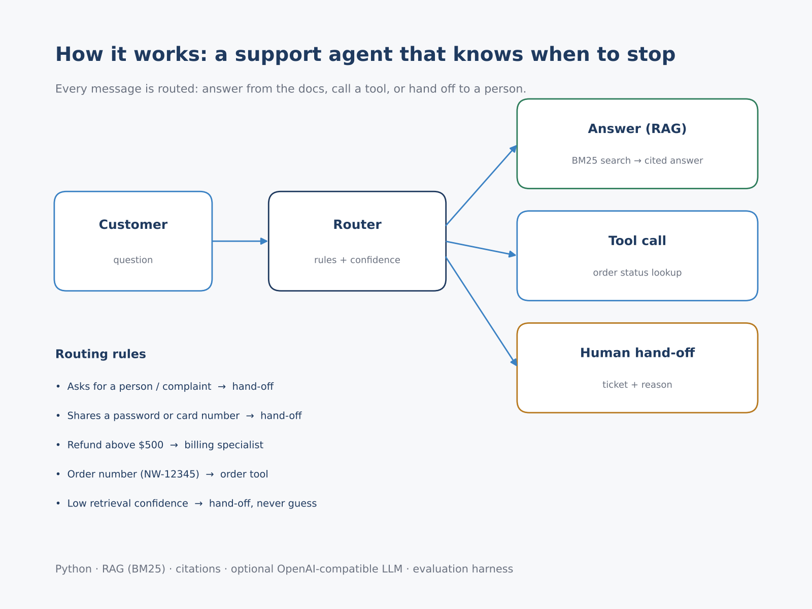
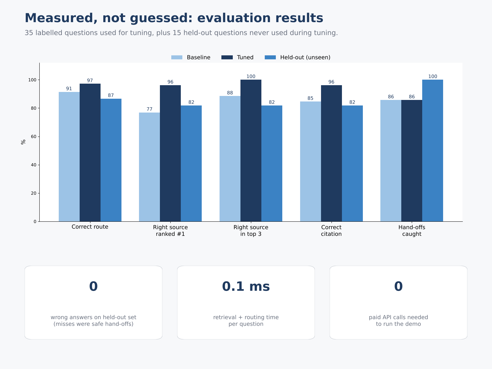
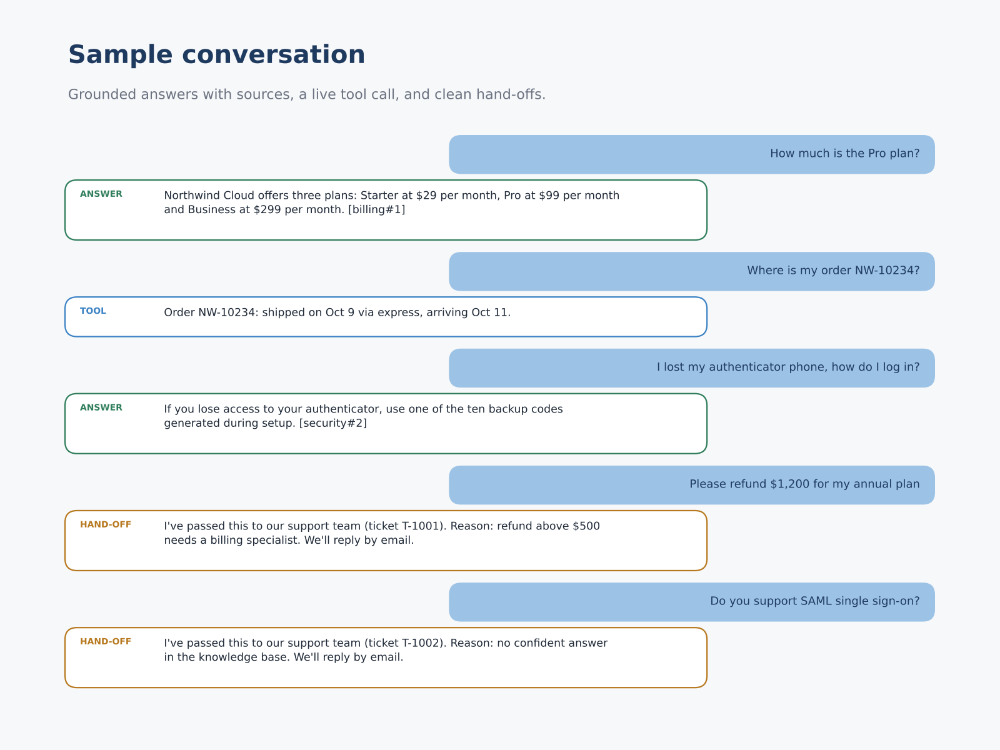

# RAG Support Agent with Evaluation (Python)

A customer-support agent that answers from company docs **with citations**, calls a tool for order status, and **hands off to a human** when it should not answer — plus an evaluation harness that measures it.

> Self-directed demo. The knowledge base (`kb_*.md`) describes a fictional company, "Northwind Cloud". Runs offline with no API key; set `OPENAI_API_KEY` to have an LLM write the final answer from the same retrieved sources.



## What it does
- **Retrieve**: BM25 search over chunked docs, with light stemming and synonym expansion
- **Answer with sources**: every answer cites the passage it came from, e.g. `[billing#1]`
- **Route** each message: answer / tool call (`NW-12345` order lookup) / human hand-off
- **Guardrails**: hand off when asked for a person, when a password or card number is shared, for refunds above $500, or when retrieval confidence is low (never guess)
- **Evaluate**: labelled question set + a held-out set never used for tuning

## Results
| Metric | Baseline | Tuned | Held-out (unseen) |
|---|---|---|---|
| Correct route | 91% | 97% | 87% |
| Right source ranked #1 | 77% | 96% | 82% |
| Hand-offs caught | 86% | 86% | 100% |

On the held-out set every miss was a safe hand-off, not a wrong answer.



## Run
```bash
python run_demo.py                                      # sample conversation
python evaluate.py                                      # tuning set (35 questions)
python evaluate.py holdout_set.json eval_results_holdout.json   # held-out set (15)
pip install matplotlib && python make_media.py          # optional: images
```
Standard library only.



## Adapting it
Replace the `kb_*.md` files with your own docs (or load from Notion / Google Drive / a help center), adjust the routing rules in `agent.py`, connect the tool to your real order system, and swap BM25 for embeddings + a vector DB when the corpus grows.
